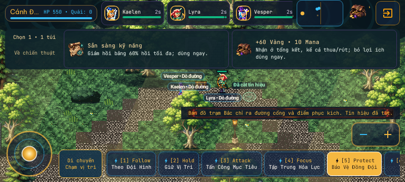
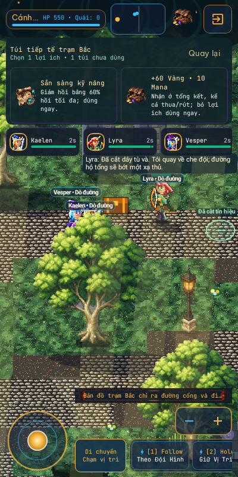
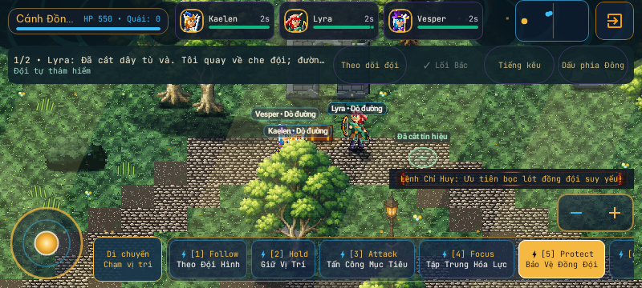

# Tower field spoils — implementation and evidence

Owner request: apply the newly supplied game-development/Sprite Forge skills in the game.
Task: GitHub Issue105. Base main: `dbc09f95579fae45e2cc29014005a8e7cdde01fc`.
Exact review HEAD and CI links are recorded on the PR; this report cannot contain its own
commit hash. PR96's LivingExpedition.kt and MechanicsTest remain untouched. PR102/104
remain separate reference installations, not dependencies that must be merged to run this APK.

## What the player gets

After physically finishing a northern, southern or eastern investigation, a small valuables
button shows available supplies. Open it to choose one mutually exclusive benefit:

| Completed site | Immediate tactical tool | Ordinary resource alternative |
|---|---|---|
| North | Reduce living heroes' skill cooldown by 60% of maximum cooldown, clamped at zero | 60 Gold + 10 Mana |
| South | Raise living heroes' shields to 25% maximum HP, retaining stronger existing shields | 65 Gold + 15 Mana |
| East | Restore 25% maximum HP, clamped; never revive fallen heroes | 75 Gold + 20 Mana |

The optional third site now supplies another distinct opportunity. Rewards are authored,
not random rolls consuming combat RNG. Their values are a bounded first tuning pass,
not human-validated economy balance or a new permanent equipment system.
Already-ready/full/strongly-shielded parties cannot waste that tactical option; valuables
remain available. Gold/Mana join existing end-of-attempt settlement, including defeat or
retreat. Unchosen offers do not silently grant anything. Shield/readiness are run-local;
actual HP still goes through the existing battle-HP persistence path.

The tray shares the current HUD slot, does not pause or seize the battlefield, and closes
without choosing. New urgent investigation decisions take precedence. A held command stays
held; reward collection is not a navigation/resume command. Evacuation is never gated on
reward collection. Repeated, wrong-site, stale or terminal clicks cannot pay twice.

## Application of learned guidance

- `level-design`: exploration earns a concrete tool; a third detour has an explicit payoff,
  retaining physical traversal, rescue decisions and extraction rather than adding timers.
- `rpg`: a readable immediate-versus-resources choice using actual existing combat stats;
  no new damage formula, grind, inflated monster HP or duplicated inventory/save model.
- Sprite Forge `generate2dsprite`: original hosted-image icon sheet, measured grid/alpha,
  raw spill QC, local normalization and runtime-size/native-screen inspection. See
  [art source, exact warnings and processing](../../assets/tower-field-rewards/README.md).
- Existing project save/input/performance contracts: one-shot markers, current idempotent
  guest/cloud settlement, no input ownership mutation, off-thread bounded icon loading.

## Verification and inspected evidence

The broad local run passed **58 tests across 11 suites**, zero failures/errors/skips,
plus `:app:assembleDebug`. Toolchain: existing JDK21, Gradle9.3.1, Android SDK36/36.1.
Temporary Google Sign-In placeholder matched the existing CI procedure and is excluded
from the commit; original debug key/config retained. Command:

```sh
JAVA_HOME=/workspace/toolchains/jdk-21 ANDROID_HOME=/workspace/toolchains/android-sdk GRADLE_USER_HOME=/workspace/toolchains/gradle-cache /workspace/toolchains/gradle-9.3.1/bin/gradle :app:testDebugUnitTest --tests com.example.ExpeditionFieldRewardsTest --tests com.example.ExpeditionFieldRewardsIntegrationTest --tests com.example.ui.ExpeditionFieldRewardUiTest --tests com.example.ui.ExpeditionRewardIconFailureTest --tests com.example.LivingExpeditionPlaythroughTest --tests com.example.LivingExpeditionControlTest --tests com.example.TowerTrustAndFeedbackTest --tests com.example.data.ExpeditionSettlementLedgerTest --tests com.example.ui.LivingExpeditionUiTest --tests com.example.ui.Floor1SettlementRecoveryUiTest --tests com.example.TowerCombatArtEvidenceTest :app:assembleDebug --console=plain
```

`local-tests.json` records the broad suite counts. A subsequently added full-three-site
acceptance case is run separately in the affected integration class; its actual outcome
and updated unique totals are recorded in `additional-integration-tests.json` and the PR.
That run passed all four integration cases: the full north/south/east route used actual
READINESS, WARD and HEALING benefits and physically rescued the courier in106.31 simulation
seconds. Across both runs there are59 unique local cases, including21 newly added cases.
No production code changed after the broad run. CI test selections include all new tests.

Real starter-party simulations cover the three original alternate routes, actual newly
claimed resource bonuses, physical witness rescue, Master HOLD/auto preservation, physical
escort extraction, restart, duplicate receipt and clean retry. Dedicated icon-failure
fixtures cover missing-second-file, corrupt PNG and wrong size, with no published partial
cache or repeated retries. These failures cannot poison gameplay; textual choices remain.

Reviewed real production Compose screens, native Robolectric SDK36 at 400x800 and800x360;
48dp minimum touch targets and >=96dp exposed battlefield are asserted. These are host
native renders, not Android screenshots from a connected phone:





[APK comparison](local-apk-comparison.json) verifies the real built APK against the prior
Part1 local APK: package/version, SDK, launcher, ABI, signing and ZIP CRC. This is not a
phone installation test or a CI-artifact comparison. Main applicationId remains
`com.aistudio.eternalsummoner.kvrpzm`; launcher is `com.example.MainActivity`.

Independent read-only Codex performance/technical review found a cosmetic-load crash risk;
root fixed it with atomic publication, recycle-on-failure and negative caching, and added
three failure tests before the broad verification. The disabled-reason text was also split
from global input gating; observations stop after active exploration. Final exact-SHA
re-review and Argon/A09 review status are reported on GitHub, not self-certified here.

## Honest gameplay assessment and remaining limits

The player now trades immediate survival/readiness against progression resources, and a
third branch has a concrete benefit. This improves one real decision loop. It does not
establish that the entire Tower is fun, endless, finished or balanced.

The unchanged original scripted two-site routes still take about 87–91 simulation seconds,
with about79–81 seconds flagged as at least one hero moving; combat/movement counters can
overlap. These are automated control paths, not human 5–10-minute playtests. Travel still
dominates those traces; the next pacing/content work must address decisions and encounter
variety, not lengthen walking or inflate HP. Current fixed reward catalogs do not provide
new affixes, permanent build collections or procedural variety by themselves. First-time
discoverability of the optional supplies button needs human observation.

No device was attached (`adb devices -l` returned an empty list). Phone installation,
touch latency, FPS/GPU completion, heat and human replay interest remain NOT TESTED;
Issue98's gameplay acceptance is not closed. New icons retain65,536 decoded bytes; the
existing overlay omits Tower atlas memory, so its displayed value is not total game RAM.
Tiny bounded snapshot/site allocations remain unprofiled; no FPS improvement is claimed.
No Sanctuary/shared renderer/shader/camera, Android configuration, save schema or economy
formulas were edited. No main push, merge or force push; independent review remains required.
